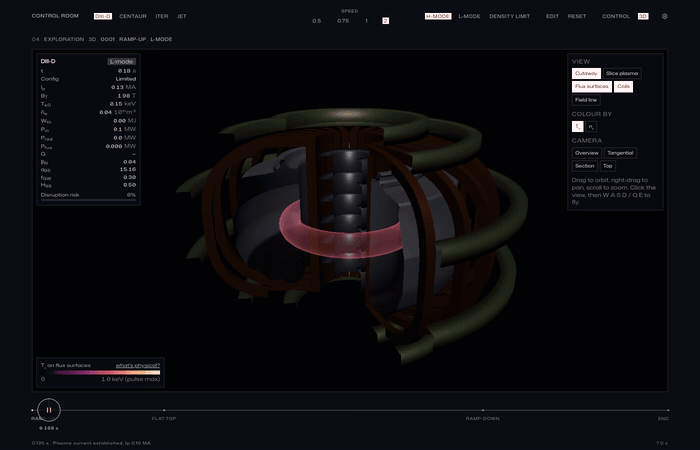
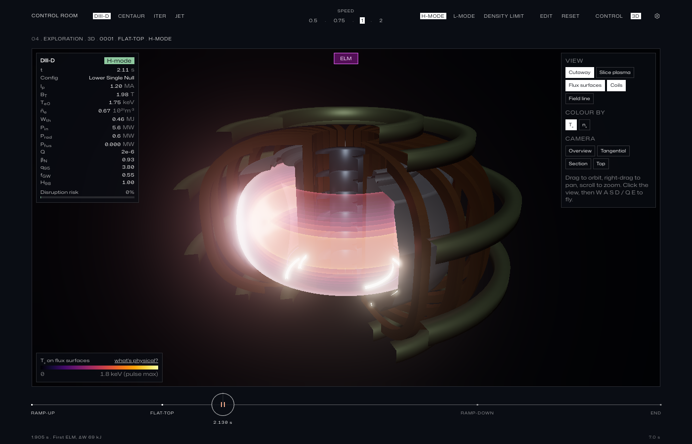
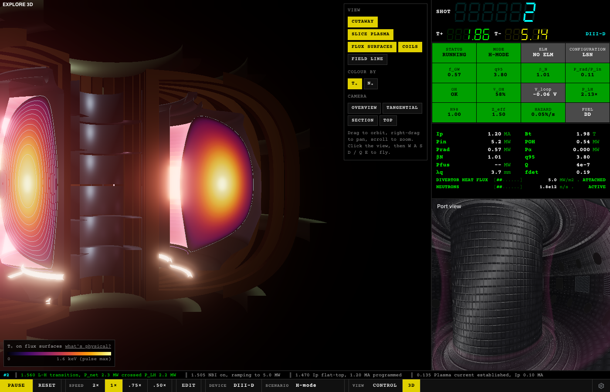
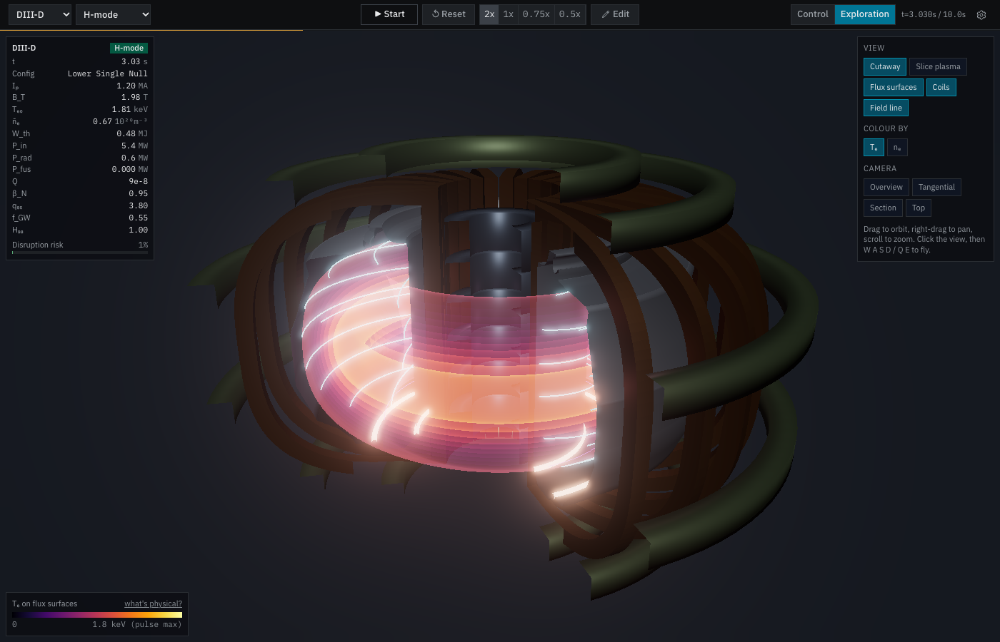
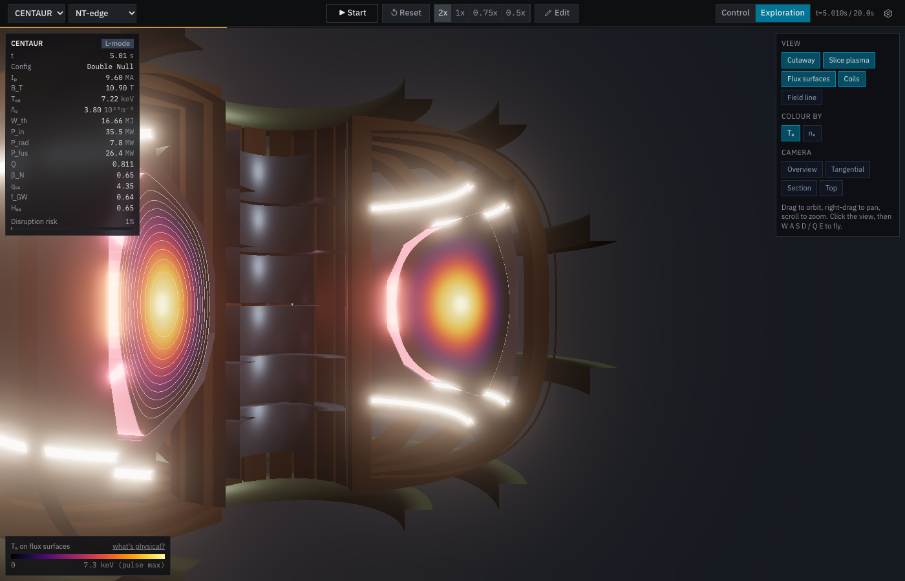
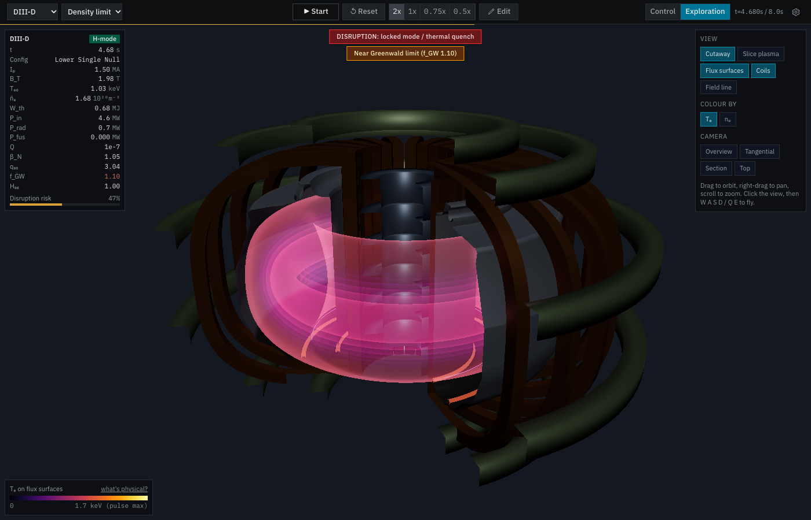
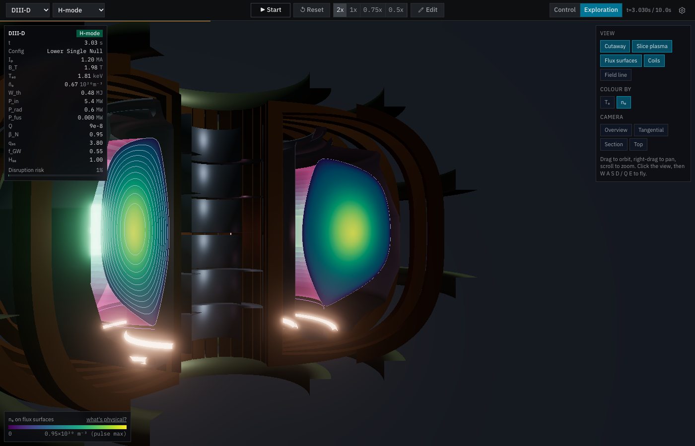

# fusion-sim-3d

> **A fork of [fusionsimulator.io](https://fusionsimulator.io) by Daniel Burgess
> (Columbia Fusion Research Center)**, upstream repository
> [d-burg/fusion-sim](https://github.com/d-burg/fusion-sim). The physics engine,
> control room, device models and everything else below the "Exploration Room"
> section are Daniel Burgess's work. This fork adds a 3D **Exploration Room**
> and is maintained by Matthew Waller. Licensed GPL-3.0, like the original.



## What this fork adds: the 3D Exploration Room

A second view next to the control room (top bar: **Control | Exploration**, or
`/run/<device>?view=explore`). Both views read the same live simulation, so you
can switch mid-pulse without resetting anything.

| | |
|---|---|
|  |  |
| DIII-D H-mode flat-top, cutaway | Plasma sliced open: Tₑ on the engine's flux surfaces |
|  |  |
| Field lines on the boundary, pitch from q₉₅ | CENTAUR negative-triangularity, double null |
|  |  |
| Density-limit preset: locked mode ahead of the quench | nₑ colouring |

- **The whole machine in three.js:** vessel/first wall revolved from each
  device's own wall contour (DIII-D, JET, ITER, CENTAUR), divertor region,
  and schematic TF coils, central solenoid and PF coils sized from the wall.
- **The plasma follows the live equilibrium.** The engine's flux-surface
  contours (ψ_N = 0.1 … 0.9 and 0.995) are resampled onto a fixed angular grid
  and swept around the torus on the GPU, so the shape tracks ramp-up, the
  limited-to-diverted transition, shaping changes and ramp-down.
- **Colour and brightness come from the engine's profiles:** Tₑ or nₑ per
  surface, brightness ∝ nₑ²√Tₑ. The edge glows with the synthetic D-alpha
  signal, ELMs flash the outboard edge, divertor strike rings brighten with the
  computed peak heat flux, and a disruption shows its locked-mode / thermal
  quench / current quench sequence.
- **Explore:** orbit/zoom/pan, W A S D / Q E fly, preset cameras (overview,
  tangential, poloidal section, top), a cutaway toggle, a "slice plasma" toggle
  that exposes the nested flux surfaces, optional field lines, and a HUD with
  live parameters, event banners and a post-pulse replay slider.
- **Performance:** geometry is built once per device. Each tick uploads one
  11 × 128 float texture of (R, Z) samples; the vertex shader does the
  revolution. The render loop pauses when the tab is hidden.

### Run it

The compiled WASM engine is checked in (`web/src/wasm/`), so the frontend runs
without a Rust toolchain:

```bash
cd web
npm install
npm run dev          # http://localhost:5173, then pick a device and Run
# or open http://localhost:5173/run/diiid?view=explore&autostart=1
```

To rebuild the engine too, use `./build.sh` (needs Rust, the
`wasm32-unknown-unknown` target and wasm-pack; see Getting Started below).

### What is physics and what is decoration

The in-app "what's physical?" note gives the same list.

- **From the engine:** flux-surface shapes, magnetic axis, X-points,
  separatrix, Tₑ/nₑ profiles, H/L mode, ELM timing and size (`elm_active`,
  `elm_energy_loss`), D-alpha, disruption state and risk, f_GW, q₉₅, and the
  other HUD values. P_fus/Q and the divertor q_peak come from the upstream
  display-side models in `web/src/lib/fusionPhysics.ts`.
- **Assumptions:** profiles are indexed by ρ, and surfaces are coloured using
  ρ ≈ √ψ_N. Brightness ∝ nₑ²√Tₑ (bremsstrahlung scaling) is a relative proxy,
  not a synthetic camera image. Field lines use the geometric poloidal angle,
  so they show the right number of transits but not the exact local pitch.
- **Schematic or decorative:** TF/CS/PF coil geometry (the engine has no coil
  model; TF counts are the real machines' 24/32/18, CENTAUR's is
  illustrative), divertor shading, plasma-coloured wall lighting, the ELM flash
  shape and decay, the disruption afterglow, and the near-camera fade.

### Code

`web/src/components/exploration/`: `scene.ts` (three.js scene, camera, cutaway,
render loop), `fluxGeometry.ts` (contour → fixed-grid resampling, with
`fluxGeometry.test.ts`), `plasmaVolume.ts` (shell shaders and cut faces),
`edge.ts` (X-points, strike rings, field lines), `machine.ts` (hardware), and
`Hud.tsx`. It follows the upstream port view's approach (plain three.js, not
react-three-fiber) and reuses its bloom pipeline and strike-point finder. The
only change to existing code is the view switch (plus `?autostart=1`) in
`web/src/pages/ControlRoom.tsx`.

---

*Original README follows.*

## fusionsimulator.io

A real-time tokamak plasma simulator that runs entirely in your browser.
fusionsimulator.io combines a Rust physics engine (compiled to WebAssembly) with a
React/TypeScript frontend to provide an interactive control room experience
for exploring tokamak plasma behavior.

## Features

- **Four tokamak devices:** DIII-D, JET, ITER, and CENTAUR (conceptual
  negative-triangularity) with device-specific geometry, heating systems,
  and engineering limits
- **Three pulse presets per device:** H-mode, L-mode, and Density Limit
  scenarios with realistic waveform programming
- **Real-time physics:** 0D power balance transport, analytic Grad-Shafranov
  equilibrium, tanh-pedestal profiles, ELM dynamics, and disruption modeling
- **Interactive control room:** 2D equilibrium cross-section, 19-channel time
  trace viewer, plasma parameter dashboard, and 3D tokamak port view
- **Pulse Planner:** Edit pulse parameters (Ip, heating power, density,
  shaping) and run custom scenarios
- **Fusion diagnostics:** Computed fusion power/Q, neutron rate, divertor heat
  flux with surface temperature modeling
- **Post-pulse analysis:** Time scrubbing, radial profile viewer with
  synthetic Thomson scattering
- **Impurity seeding:** Nitrogen, neon and argon gas lines per machine, with
  ADAS cooling curves for core radiation, Z_eff and dilution, a
  Goldston-Reinke-Schwartz detachment threshold, and a radiating divertor
  front tinted by the seeded species
- **Hall audio (opt-in):** Synthesized machine sounds from the torus hall,
  driven by the live state: coil and converter hum at the site's mains
  frequency, flywheel generators sagging under load, beam-line noise, the
  cryoplant on superconducting machines, and the thud of a disruption. A
  separately labeled sonified D-alpha channel clicks once per ELM. Off by
  default; the plasma itself is silent
- **Pulse sonification (opt-in):** The pulse as sound, labeled as such: a
  converter whine whose pitch climbs with the current ramp and whose level
  follows the Ohmic drive power, a sub-100 Hz rumble from the power crossing
  the separatrix, a broadband roar that follows the divertor heat flux and
  surges when the divertor lights up at the L-H transition, and a neutron
  detector whose Poisson crackle gates the whole layer as the fusion power
  rises. A DD pulse ticks; a DT burn crackles
- **Pulse record:** Persistent pulse numbers, an append-only event log with
  alarm severities, a named cause and operator action for every disruption,
  an achieved-versus-programmed report, and the previous pulse as a reference
  trace

## Physics Models

The simulator implements peer-reviewed physics models from the fusion literature:

| Model | Reference |
|-------|-----------|
| MHD equilibrium | Cerfon-Freidberg analytic Grad-Shafranov (PoP 2010) |
| Energy confinement | IPB98(y,2) scaling (ITER Physics Basis, NF 1999) |
| L-H transition | Martin power threshold scaling (JPCS 2008) |
| Beta limit | Troyon normalized beta limit (PPCF 1984) |
| Density limit | Greenwald limit (PPCF 2002) |
| Fusion reactivity | Bosch-Hale parameterization (NF 1992) |
| Divertor heat flux | Eich SOL width scaling (NF 2013) |
| Radial profiles | OMFIT tanh-pedestal parameterization |

For complete citations and equations, see the in-app Bibliography page.

> **Disclaimer:** fusionsimulator.io uses 0D scaling laws and analytic approximations.
> It is an educational and visualization tool, not a predictive transport code.

## Getting Started

### Prerequisites

- [Rust](https://rustup.rs/) (stable toolchain)
- [wasm-pack](https://rustwasm.github.io/wasm-pack/installer/) (`cargo install wasm-pack`)
- [Node.js](https://nodejs.org/) 18+ with npm

### Quick Start

```bash
# Clone the repository
git clone <repo-url> fusion-sim-3d
cd fusion-sim-3d

# Full build (WASM engine + frontend)
./build.sh

# Serve the built app
cd web && npx vite preview
```

### Development

```bash
# Build WASM module
wasm-pack build crates/tok-sym-core \
  --target web \
  --out-dir ../../web/src/wasm \
  --no-default-features \
  --features wasm

# Start frontend dev server (with hot reload)
cd web
npm install
npm run dev
```

The dev server runs at `http://localhost:5173` by default.

### Running Tests

```bash
# Exploration Room geometry tests (standalone, like the upstream TS test)
cd web && npx tsx src/components/exploration/fluxGeometry.test.ts

# Rust physics engine tests (full-pulse tests are slow in debug; use --release)
cargo test --release -p tok-sym-core

# Envelope sweep: every planner control at five levels on every device and
# preset, run through the engine and checked for plausibility (~5 min on 6
# cores). Regenerate the program matrix whenever a preset, a slider range or
# the program builder changes; the matrix check fails when it is stale.
cargo test --release -p tok-sym-core --test envelope -- --nocapture
cd web && npm run matrix:emit && npm run matrix:check

# TypeScript type checking
cd web && npx tsc -b

# Lint
cd web && npm run lint
```

### Generating Rust API Docs

```bash
cargo doc -p tok-sym-core --no-deps --open
```

This opens the auto-generated API documentation for the physics engine in
your browser. All public types and functions are documented with rustdoc
comments.

## Project Structure

```
fusion-sim/
├── crates/tok-sym-core/   Rust physics engine (~5,500 lines)
│   └── src/
│       ├── equilibrium.rs   Cerfon-Freidberg Grad-Shafranov solver
│       ├── transport.rs     0D power balance (IPB98, L-H, ELMs)
│       ├── profiles.rs      Tanh-pedestal radial profiles
│       ├── devices.rs       DIII-D, JET, ITER, CENTAUR definitions
│       ├── disruption.rs    Disruption risk & dynamics
│       ├── diagnostics.rs   Synthetic diagnostic signals
│       ├── contour.rs       Marching squares contour extraction
│       ├── simulation.rs    Top-level orchestrator
│       └── wasm_api.rs      WASM-bindgen API surface
│
├── web/                   React frontend (~11,600 lines)
│   └── src/
│       ├── lib/             Shared libraries (WASM init, hooks, physics)
│       ├── components/      UI components (canvas, panels, 3D view)
│       ├── pages/           Route pages (DeviceSelect, ControlRoom, etc.)
│       └── wasm/            Generated WASM output
│
├── build.sh               Full build script
└── ARCHITECTURE.md        Comprehensive architecture guide
```

For detailed documentation of every module, function, and component, see
[ARCHITECTURE.md](ARCHITECTURE.md).

## Tech Stack

- **Physics engine:** Rust, compiled to WebAssembly via wasm-pack
- **Frontend:** React 19, TypeScript 5.9, Vite 7.3
- **Styling:** Tailwind CSS 4.2
- **3D rendering:** Three.js with custom GLSL shaders
- **2D rendering:** HTML Canvas API
- **Routing:** React Router v7

## Architecture Overview

```
┌─────────────────────────────────────────────────┐
│                  Browser                         │
│                                                  │
│  ┌──────────────┐    ┌────────────────────────┐  │
│  │  Rust/WASM   │───▶│  React/TypeScript      │  │
│  │  Physics     │JSON│                        │  │
│  │  Engine      │◀───│  useSimulation hook    │  │
│  │              │    │    │                    │  │
│  │ • Equilibrium│    │    ├─ EquilibriumCanvas │  │
│  │ • Transport  │    │    ├─ StatusPanel       │  │
│  │ • Profiles   │    │    ├─ UnifiedTracePanel │  │
│  │ • Disruption │    │    ├─ PortView (3D)     │  │
│  │ • Contours   │    │    └─ PulsePlanner      │  │
│  └──────────────┘    └────────────────────────┘  │
└─────────────────────────────────────────────────┘
```

All physics runs in the WASM module. The TypeScript layer handles rendering,
user interaction, and some display-only derived computations (fusion Q,
divertor heat flux via Bosch-Hale and Eich scaling).

## License

GNU General Public License v3.0 (GPL-3.0-only). See [LICENSE](LICENSE) for details.

## Attribution

Developed by Daniel Burgess and the Columbia Fusion Research Center.

Copyright 2026 Daniel Burgess. Released under the GPL-3.0 license.
